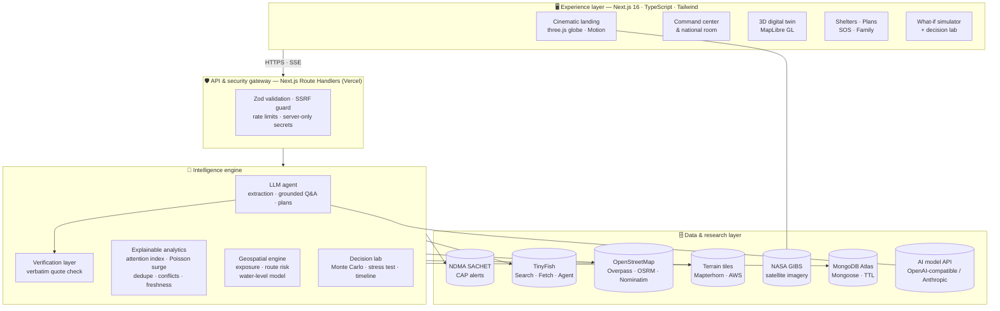
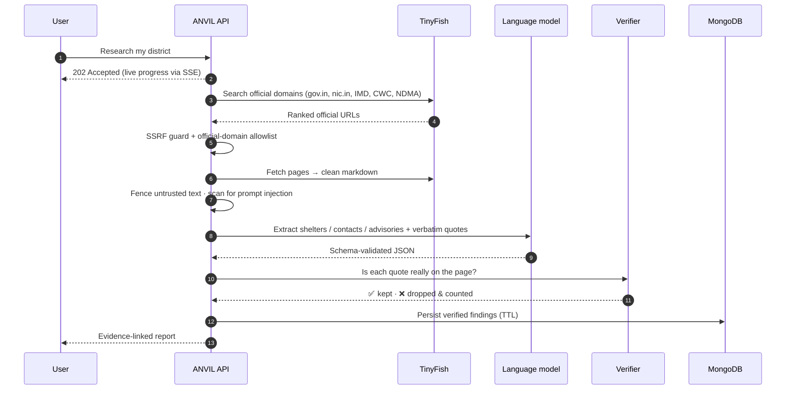

<div align="center">

# ⚡ ANVIL AI

### See the Risk. Understand the Impact. Prepare Smarter.

**India's official disaster warnings — matched to your district, verified against their source, shown in 3D, and turned into action.**

[](https://nextjs.org)
[](https://www.typescriptlang.org)
[](https://www.mongodb.com/atlas)
[](https://docs.tinyfish.ai)
[](https://maplibre.org)
[](https://threejs.org)
[](https://vercel.com)
[](#-testing)

**Built for AzinHack'26 · Elysian Tech Fest · Conducted by IOSC**

[🔗 Live demo](#) · [🎬 Demo video](#) · [📊 Pitch deck](#) · [🧠 Architecture](#-system-architecture)

</div>

---

## 🚨 The problem: the warning exists — the answer doesn't reach people

It's 2 AM. A flood alert lights up your phone.

> ❓ *Does this cover **my** street?*
> ❓ *Where is the nearest relief camp?*
> ❓ *Is that WhatsApp forward real?*

India already has a strong warning system. IMD, the Central Water Commission and state disaster authorities issue official alerts through **NDMA's SACHET** platform. India's *National Policy on Disaster Management (2009)* notes that **58.6% of the country's land is prone to earthquakes**, **over 40 million hectares to floods**, and **~5,700 km of its 7,516 km coastline to cyclones and tsunamis**.

But between the official warning and a family's next step lies a dangerous gap:

| The gap | Why it hurts |
|---|---|
| 🗺️ **Alerts name areas in official terms** | People can't tell whether *their* village or ward is covered |
| 📄 **Help is scattered** | Relief camps and control-room numbers sit across dozens of district websites, notices and PDFs |
| ⏳ **Information goes stale** | Pages aren't updated; numbers conflict |
| 🤖 **Chatbots guess** | Generic AI can confidently invent a shelter or a phone number — the most dangerous failure in an emergency |
| 🧭 **Responders lack a spatial picture** | Which homes and roads are inside the hazard zone? What if a shelter fills up? |

**ANVIL AI closes this last-mile gap.**

---

## 💡 The solution

ANVIL is a full-stack disaster-intelligence platform that turns scattered official warnings into **one trusted place to see the risk, understand the impact and act in time** — built on a single uncompromising rule:

> ### 🔒 *No source, no claim.*
> Every shelter, phone number and advisory ANVIL shows must quote the exact sentence it came from on an official page — and ANVIL checks that quote word for word before anyone sees it. If it can't prove it, it doesn't show it.

### Predict · Protect · Respond · Recover

| | What ANVIL does |
|---|---|
| 🛰️ **Predict** | Live official alerts from NDMA SACHET, matched to your district and ranked by what matters to *you*; surge detection across states; a national situation room |
| 🛡️ **Protect** | Personalised household safety plans in **English and Hindi**, emergency-bag builder, family emergency card, timed evacuation drills, geofenced watch areas |
| 🚑 **Respond** | Verified shelters with distance and live alert-area checks, **lowest-exposure road routing**, nearby help, a **3D digital twin**, and **one-tap SOS** |
| 🔁 **Recover** | Family check-in, scheduled source monitors, and a **what-if simulator** to stress-test response plans before disaster does |

---

## ✨ Feature showcase

### 🌍 Cinematic live landing page
A real-time **three.js globe** textured with **NASA Blue Marble + yesterday's VIIRS satellite pass + city lights**. Every state with active official alerts rises as a glowing beam — height by count, colour by severity. Scroll, and the camera flies into India. Live counters, scroll-lit storytelling and Motion-powered scenes — all driven by the **live official feed**, never mock data.

### 📡 Live alert intelligence
- Pulls the **SACHET all-India feed** and each alert's full **CAP 1.2** record (severity, urgency, certainty, area, expiry, instructions)
- Matches alerts to the user's **district and state**, classifies freshness (`ACTIVE / EXPIRED / STALE / UNKNOWN`) and de-duplicates
- **Attention index** ranks alerts by severity × urgency × certainty × relevance × recency
- **Poisson surge detection** flags unusual spikes in alert rates per state and district

### 🔍 TinyFish-powered research agent — with receipts
- **TinyFish Search** finds official pages (`*.gov.in`, `*.nic.in`, IMD, CWC, NDMA) for any district
- **TinyFish Fetch** turns them into clean text; **TinyFish Agent** navigates portals that need clicks
- A language model extracts **relief camps, helplines and advisories — each with a verbatim quote**
- ANVIL **verifies every quote against the fetched page**; failures are dropped and counted, never shown
- Live progress streams to the UI over **Server-Sent Events**; **scheduled monitors** re-check sources automatically

### 🏙️ 3D digital twin
- **MapLibre GL** with OpenFreeMap vector buildings, **live OpenStreetMap buildings via Overpass**, and **Mapterhorn terrain** (AWS Terrarium fallback) with hillshade and adjustable exaggeration
- Official alert areas drawn as hazard zones; click any building to inspect it
- **Exposure analysis** counts mapped buildings and roads inside a hazard area (and says plainly that unmapped buildings are invisible to it)
- A labelled terrain-based **water-level what-if** model

### 🏠 Verified shelter finder
- Only shelters documented on official pages — each with **quote, source link and verification time**
- **Distance sorting**, **live check: "inside an active alert area?"**, nearest safe shelter highlight
- **Lowest-exposure route** to any shelter (km inside alert polygons, severity-weighted) drawn on the map
- List ↔ map views, Google Maps directions, WhatsApp sharing

### 📋 Safety plan + household readiness
- Ordered by authority: **official CAP instructions (verbatim) → verified district contacts & shelters → labelled checklist**
- **Readiness score (0–100)** — plan freshness, checklist, emergency bag, family card, drill
- **Live staleness check**: if a new official alert arrives after the plan was made, ANVIL tells you to update it
- **Emergency-bag builder** sized to the household (water, food, medicines, children, elderly, pets)
- **Family emergency card** (meeting points + contacts) — printable or shareable on WhatsApp
- **Timed evacuation drill** with personal-best tracking

### 🧪 What-if simulator + decision lab
- **Live-seeded** with real documented shelters and real road distances, or a fictional **training district**
- Practice presets: cyclone landfall, flash flood at night, severe thunderstorm, heatwave cooling
- **Hour-by-hour playback** of evacuee arrivals and shelter load
- **Weakest-link stress test** — which single shelter failure leaves the most people without a place
- **Monte Carlo risk odds** — hundreds of randomised road-failure runs → probability everyone is sheltered, P50/P90 shortfall, most-strained shelter
- Every output is **labelled SIMULATION** and stored separately from live data

### 🆘 SOS & signal
- One-tap **112** and family-card contacts
- **GPS help message** (needs, people count, battery, nearest documented shelter) → share sheet, **WhatsApp**, **SMS to all family contacts** (SMS works over basic cellular signal when mobile data drops), or copy
- **Torch SOS** (Morse ··· ––– ··· via the camera torch on supported devices), **full-screen light signal**, and a **siren**
- Your location goes only to the people you choose — never to ANVIL's servers

### 👨‍👩‍👧 More
National situation room · Ask ANVIL (grounded Q&A) · Nearby help (OpenStreetMap facilities) · Smart geofenced alerts · Family check-in (consent-based, 72-hour auto-deletion) · Source-health admin · Command palette (`Ctrl K`) · Dark/light themes · Large text and reduced-motion support

---

## 🧠 System architecture



### 🔄 How a fact travels from a government page to your screen



### 🧩 Layered view

```
┌──────────────────────────────────────────────────────────────────────────┐
│ 1. EXPERIENCE   Landing (three.js) · Command center · 3D twin · Shelters │
│                 Safety plan · Simulator · SOS · Family · National room   │
├──────────────────────────────────────────────────────────────────────────┤
│ 2. GATEWAY      Zod · SSRF guard · rate limits · secrets server-side     │
├──────────────────────────────────────────────────────────────────────────┤
│ 3. INTELLIGENCE LLM agent → Verification layer → Explainable analytics   │
│                 Geospatial engine · Decision lab (Monte Carlo)           │
├──────────────────────────────────────────────────────────────────────────┤
│ 4. DATA         SACHET · TinyFish · OSM/Overpass/OSRM · terrain · NASA   │
│                 MongoDB Atlas (TTL retention)                            │
├──────────────────────────────────────────────────────────────────────────┤
│ 5. DELIVERY     Scheduled monitors · watch areas · WhatsApp · SMS SOS    │
└──────────────────────────────────────────────────────────────────────────┘
```

---

## 🤖 Role of AI & machine learning

> **AI finds it. Verification proves it. Maths explains it. People decide.**

| Layer | What it does | Status |
|---|---|---|
| **AI-assisted research** | A language model reads official pages and extracts shelters, contacts and advisories; writes bilingual safety checklists; answers grounded questions | ✅ Live |
| **Verification layer** | Every extracted fact must carry a quote found word for word on the source page — or it's rejected. Untrusted web text is fenced off from instructions | ✅ Live |
| **Explainable analytics** | Attention index, Poisson surge detection, duplicate/conflict/staleness detection — every score shows its working | ✅ Live |
| **Geospatial intelligence** | Exposure analysis, severity-weighted route risk, terrain water-level model | ✅ Live |
| **Decision lab** | Monte Carlo risk odds, weakest-link stress test, evacuation timeline | ✅ Live |
| **Predictive ML** | Satellite flood mapping (NASA-IBM **Prithvi** / U-Net on Sentinel-1 radar), **LSTM** river-level forecasting on CWC gauges, building-damage detection (xBD), misinformation classifier, **IndicTrans2** + voice input | 🔷 Roadmap |

ANVIL deliberately keeps today's scoring **explainable rather than black-box** — in public safety, people must be able to see *why* an alert was ranked first.

---

## 🛠️ Tech stack

| Layer | Technology |
|---|---|
| **Framework** | Next.js 16 (App Router, Route Handlers, `after()`), React 19, TypeScript (strict) |
| **UI** | Tailwind CSS 4, Motion, GSAP ScrollTrigger, lucide-react, Recharts |
| **3D & maps** | three.js (live globe), MapLibre GL 5 (3D twin), Leaflet / react-leaflet (2D maps) |
| **Web research** | TinyFish Search · Fetch · Agent (SSE) |
| **AI** | OpenAI-compatible Chat Completions (Gemini, OpenAI, Groq…) or Anthropic Messages API |
| **Data** | MongoDB Atlas + Mongoose (TTL retention), in-memory fallback for local demos |
| **Open data** | NDMA SACHET CAP feed, OpenStreetMap (Overpass, Nominatim), OSRM routing, OpenFreeMap, Mapterhorn & AWS terrain, NASA GIBS imagery, Sentinel-2 cloudless (EOX) |
| **Validation & security** | Zod schemas, SSRF guard, official-domain allowlist, rate limiting, prompt-injection fencing |
| **Testing** | Vitest |
| **Hosting** | Vercel (serverless functions + cron) |

---

## 🔐 Security & trust by design

- **Zod validation** on every request and every external payload
- **Server-only secrets** — `/api/config` exposes capability booleans only; no key ever reaches the browser
- **SSRF protection** — outbound URLs must be HTTPS, non-IP, non-private, no credentials, standard ports; research is restricted to official government domains; off-domain redirects are discarded
- **Prompt-injection defence** — web text is wrapped in nonce-delimited untrusted blocks and scanned for injection patterns
- **Per-route rate limits**, hard timeouts and size caps on every upstream call
- **Privacy** — location rounded to ~1 km on-device; SOS location is shared only with contacts you choose; anonymous device IDs; family check-in data auto-deletes after 72 hours; "Delete my data" clears everything
- **Honest labelling** — official alerts, verified findings, simulations and assumptions are always visually distinct

---

## 🗺️ App map

| Route | Page |
|---|---|
| `/` | Cinematic live landing page |
| `/onboarding` | Location: GPS, search or labelled demo preset |
| `/dashboard` | Command center for your district |
| `/national` | National situation room |
| `/alerts` | Live official alerts |
| `/map` · `/map3d` | Hazard-aware routing · 3D digital twin |
| `/research` · `/agent` | Live research agent · shelter & contact research |
| `/shelters` · `/nearby` | Verified shelters · nearby help |
| `/plan` | Safety plan, emergency bag, family card, drill |
| `/simulator` | What-if simulator + decision lab |
| `/sos` | SOS & signal |
| `/watch` · `/family` | Smart geofenced alerts · family check-in |
| `/ask` | Grounded Q&A |
| `/settings` · `/admin` | Preferences & privacy · source health |

---

## 🚀 Getting started

**Requires Node.js ≥ 20.9**

```bash
git clone https://github.com/<your-org>/<your-repo>.git
cd <your-repo>
npm install
cp .env.example .env.local      # fill in what you have — everything is optional for a first run
npm run dev                     # → http://localhost:3000
```

With **no keys at all** you still get live SACHET alerts, location, dashboard, 3D map, routing, safety plans (template checklist), the simulator and SOS — on ephemeral storage.

### Environment variables

| Variable | Purpose |
|---|---|
| `MONGODB_URI` | MongoDB Atlas connection string (persistence) |
| `TINYFISH_API_KEY` | TinyFish Search + Fetch for the research agent |
| `TINYFISH_AGENT_ENABLED` | `true` to allow TinyFish Agent browser runs (uses credits) |
| `AI_PROVIDER` | `openai-compatible` or `anthropic` |
| `AI_API_KEY` · `AI_MODEL` · `AI_BASE_URL` | AI provider credentials, model and base URL (e.g. Gemini's OpenAI-compatible endpoint) |
| `CRON_SECRET` | Protects `/api/cron/monitor` for scheduled monitors |
| `GEOCODER_CONTACT` | Contact e-mail for Nominatim's usage policy |
| `MAP_TILE_URL` · `MAP_TILE_ATTRIBUTION` | 2D map tiles |
| `ROUTING_BASE_URL` | OSRM-compatible routing server |
| `OVERPASS_URL` | Overpass API endpoint |
| `ADMIN_TOKEN` | Protects detailed `/admin` probes |
| `NEXT_PUBLIC_APP_URL` | Public base URL |

> 🔑 **Never commit keys.** Put them in `.env.local` locally and in **Vercel → Project → Settings → Environment Variables** for production.

### Commands

```bash
npm run dev         # development server
npm test            # Vitest test suite
npm run typecheck   # tsc --noEmit
npm run lint        # ESLint
npm run build       # production build
npm start           # serve the production build
```

### Deploy to Vercel

1. Import the GitHub repo into Vercel
2. Add the environment variables above
3. Deploy — `vercel.json` schedules the source monitor (`/api/cron/monitor`) daily
4. Add Vercel's egress to your MongoDB Atlas network access list (or allow `0.0.0.0/0` for the demo)

---

## 📁 Project structure

```
src/
├── app/
│   ├── page.tsx                  # cinematic landing (three.js + Motion + GSAP)
│   ├── onboarding/               # location setup
│   ├── (app)/                    # command-center pages (dashboard, map3d, plan, sos, …)
│   └── api/                      # route handlers: alerts, research, shelters, plans,
│                                 # route, hazard-map, national, simulator, osm, cron, …
├── components/
│   ├── landing/                  # globe, hero, stats, scroll scenes, motion kit
│   ├── map3d/                    # 3D digital twin workspace, terrain, styles
│   ├── plan/                     # readiness ring, emergency bag, family card, drill
│   ├── simulator/                # live + training simulators, decision lab
│   ├── sos/                      # torch / screen / siren signal tools
│   └── layout/ ui/ shared/ maps/ # shell, primitives, tabs, map views
├── lib/
│   ├── core/                     # dependency-free, unit-tested logic:
│   │   ├── cap.ts xml.ts         #   SACHET RSS + CAP 1.2 parsing
│   │   ├── intelligence.ts       #   attention index, Poisson surge, national picture
│   │   ├── verify.ts evidence.ts #   verbatim-quote verification, conflicts
│   │   ├── sanitize.ts           #   untrusted-content fencing, injection detection
│   │   ├── url-safety.ts         #   SSRF guard, official-domain allowlist
│   │   ├── geometry.ts geo3d/    #   exposure, route risk, inundation, spatial index
│   │   ├── live-sim.ts sim-analytics.ts  # planner, Monte Carlo, stress test, timeline
│   │   └── readiness.ts          #   emergency bag + readiness score
│   ├── agent/                    # research state machine
│   ├── tinyfish.ts ai.ts         # provider clients (timeouts, schema-validated)
│   └── sources/sachet.ts         # feed + CAP fetching, caching, bounded concurrency
└── models/                       # Mongoose models with TTL retention
tests/core/                       # 138 core tests
```

---

## 🧪 Testing

**138 core tests** cover the logic that matters most: CAP parsing, freshness, location matching, SSRF protection, quote verification, conflict detection, prompt-injection detection, geospatial exposure, route risk, the inundation model, the simulator planner, Monte Carlo analytics, readiness scoring and the landing-globe maths.

```bash
npm test
```

---

## 📈 Expected impact

- ⚡ **From warning to action in minutes** — "Does this cover me, and where do I go?" answered on one screen
- 🔒 **Zero invented facts** — every shelter and helpline links to its official source
- 🚑 **Rescue where it's needed first** — responders see exposed homes and roads on a 3D map
- 🛡️ **Preparation, not panic** — plans, bags, family cards and drills before disaster strikes

**Proposed pilot targets:** nearest documented shelter found in under 60 seconds · 100% of facts shown carry a working official source link · a measurable rise in households with a complete safety plan.

> India has shown what early action can do — Odisha moved about **12 lakh people** to safety before **Cyclone Fani (2019)**. ANVIL aims to put that clarity in every pocket.

---

## 🛣️ Roadmap

| Phase | Scope |
|---|---|
| ✅ **Now — MVP** | Live alerts, 3D twin, TinyFish research, verified shelters, plans, simulator, SOS — deployed |
| 🔷 **Next — Pilot** | One district with an NGO / DDMA partner; validate findings against official records; user testing in Hindi & English |
| 🔷 **Then — Predictive AI** | LSTM river forecasting (24–72 h), Prithvi satellite flood mapping, misinformation detection |
| 🔷 **Later — Scale** | All 22 scheduled Indian languages, SMS/WhatsApp alert delivery, offline PWA, state control-room integration, cross-border river feeds (e.g. Nepal) |

---

## ⚠️ Honest limits

- Building coverage depends on OpenStreetMap and varies by area
- The water-level model is illustrative — **not** a hydrological forecast
- District matching is text-based (LGD-code matching is on the roadmap)
- Free-tier hosting limits how often scheduled monitors run
- Shelter availability is **never** claimed unless the official source says so
- ANVIL is an information aid and a hackathon prototype — **not an official government service**

> 🆘 **In an emergency, always call 112** and follow instructions from NDMA, IMD and your local authorities.

---

## 🙏 Credits & data sources

**Alerts:** NDMA SACHET public CAP feed · **Web research:** [TinyFish](https://docs.tinyfish.ai) · **Maps:** © OpenStreetMap contributors, OpenFreeMap, OSRM · **Terrain:** Mapterhorn, AWS Terrain Tiles · **Imagery:** NASA GIBS (Blue Marble, VIIRS), Sentinel-2 cloudless by EOX (contains modified Copernicus Sentinel data) · **Policy figures:** National Policy on Disaster Management 2009, NDMA, Government of India

---

<div align="center">

## 👥 Team

**[Team Name]** — [Member 1] · [Member 2] · [Member 3] · [Member 4]
[College / Institution]

Built with ❤️ for **AzinHack'26 · Elysian Tech Fest · IOSC**

### ⚡ ANVIL AI — *India's warnings, finally made usable.*

</div>